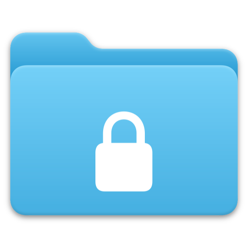
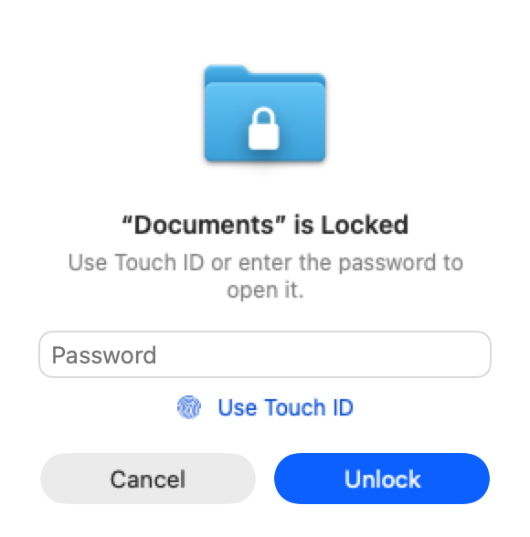
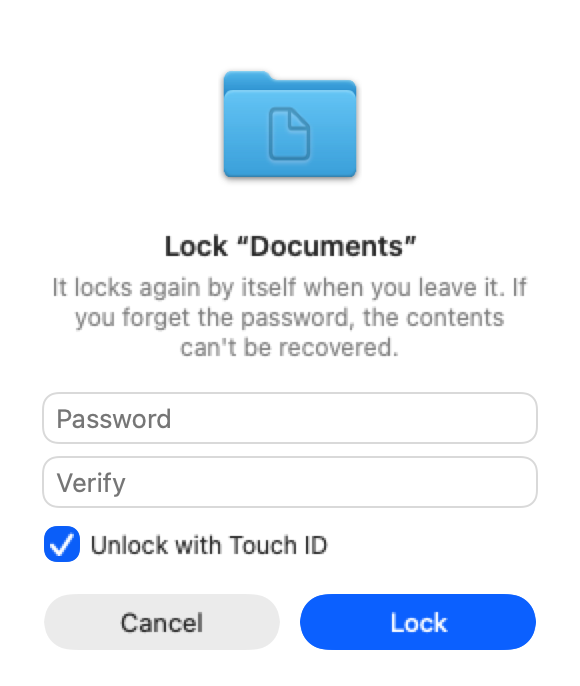
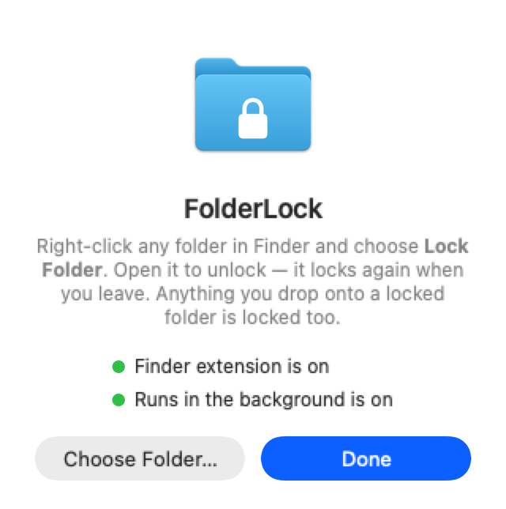

<p align="center">
  
</p>

<h1 align="center">FolderLock</h1>

<p align="center">
  <b>Lock any folder on your Mac with a password or Touch ID — right from Finder.</b><br>
  Free, open source, and it feels like something Apple built.
</p>

<p align="center">
  
  
  
  
  
</p>

<p align="center">
  <picture>
    <source media="(prefers-color-scheme: dark)" srcset="docs/unlock-dark.png">
    
  </picture>
  &nbsp;&nbsp;
  <picture>
    <source media="(prefers-color-scheme: dark)" srcset="docs/lock-dark.png">
    
  </picture>
</p>

---

## ✨ What it does

- **Right-click → Lock Folder.** It's right in Finder's main menu, no Services submenu.
- **Just open it to unlock.** Opening a locked folder in Finder brings up a Touch ID / password window by itself.
- **Use it like a normal folder.** Once unlocked you open, edit, add and delete files as usual, with no extra prompts.
- **Locks itself when you leave.** About 2 seconds after you close the folder's Finder window it's encrypted again. It also locks when your screen locks or your Mac sleeps.
- **Drop to lock.** Drag a file onto a locked folder and it goes straight into the encrypted vault (you get a notification).
- **Won't break your work.** If another app still has a file from the folder open, FolderLock waits before locking.
- **Real encryption.** It doesn't just hide files. Contents are stored with **AES-256** in an encrypted disk image, using Apple's own `hdiutil`.
- **The folder stays a folder.** Move it, rename it or back it up and it stays protected, because the encrypted vault lives inside it.

## 🎬 How it works

```
 ┌──────────── unlocked ────────────┐          ┌───────────── locked ─────────────┐
 │ 📁 School                         │  leave   │ 📁🔒 School                        │
 │   ├── notes.pdf                   │ ───────▶ │   └── .folderlock.sparsebundle    │
 │   ├── homework/                   │  (auto)  │         (AES-256 encrypted vault) │
 │   └── .folderlock.sparsebundle    │ ◀─────── │                                   │
 └───────────────────────────────────┘  Touch ID└───────────────────────────────────┘
                                        / password
```

| Piece | What it does |
| --- | --- |
| `FinderSync.swift` | A **Finder Sync extension**: adds the right-click menu items and tells the app when a protected folder is opened. |
| `main.swift` | The **background app** (no Dock icon): the encrypted vault, the SwiftUI windows, auto-relock, drop-to-lock, Touch ID and Keychain. |
| `build.sh` | Builds everything with just the Xcode Command Line Tools, signs it, installs it in `/Applications` and turns on the Finder extension. |

The folder's password is kept in your **login Keychain**, so the folder can lock itself again without asking you, and so Touch ID can unlock it.

## 🚀 Install

**Option 1: download.** Grab `FolderLock.zip` from [Releases](../../releases), unzip it and move `FolderLock.app` to **Applications**.
The app isn't notarized by Apple yet, so the first time you open it go to **System Settings → Privacy & Security → Open Anyway**.

**Option 2: build from source** (needs only the free Command Line Tools, not the full Xcode):

```bash
xcode-select --install   # if you don't have them yet
git clone https://github.com/alidiab2/FolderLock.git
cd FolderLock
./build.sh
```

Then open **FolderLock** once from Applications. The welcome window shows whether the Finder extension and background mode are on, with a **Turn On** button if either isn't.

> The first time it runs, macOS asks to let FolderLock **control Finder**. Click **Allow**: that's how it knows when you've left a folder so it can lock it again.

## 🧭 Use

1. Right-click a folder → **Lock Folder** → choose a password (Touch ID is on by default).
2. To open it, just open it in Finder → touch the sensor or type the password.
3. Leave it and it locks itself. Or right-click → **Lock Now**.
4. To stop protecting a folder: unlock it, then right-click → **Remove Lock…**

<p align="center">
  <picture>
    <source media="(prefers-color-scheme: dark)" srcset="docs/home-dark.png">
    
  </picture>
</p>

## 🔐 Security, honestly

FolderLock aims to be **good everyday protection** for school, work or personal files on a shared Mac. Know its limits:

- **Forget the password and Touch ID isn't set up? The files are gone.** There's no back door.
- While a folder is **unlocked**, its files are ordinary files on disk. Turn on **FileVault** for full-disk protection.
- **Time Machine** backups taken while a folder was unlocked contain readable copies.
- Files deleted from an SSD aren't instantly unrecoverable at the hardware level (that's how flash storage works). FileVault covers this too.
- The app is ad-hoc signed, so its Touch ID check is enforced by the app rather than bound to the Secure Enclave. A properly signed build could fix this (see below 👇).

Found a security issue? Please open an issue, or contact the maintainer privately for anything sensitive.

## 🤝 Help make it better

This project was started in a single afternoon, and **there's a lot of room to grow**. Contributions of any size are very welcome, whether you're a seasoned Swift developer or this is your first pull request.

Ideas to pick up:

- [ ] 🔏 **Developer ID signing + notarization** so it installs with no warnings, and Keychain items bound to Touch ID in the Secure Enclave
- [ ] 🌍 **Translations**: Arabic, Hebrew, Spanish, … (all the strings are in `main.swift`)
- [ ] 🗂 **Finder tabs**: Finder's AppleScript only exposes the visible tab of each window
- [ ] 🔑 **Change password** for an existing folder
- [ ] ⚡ **Incremental re-locking** for very large folders (only re-encrypt changed files)
- [ ] 🧩 **Menu bar item** listing protected folders, with "Lock All"
- [ ] 🧪 **Tests** for the vault engine (`Vault` enum), which already has a headless CLI mode (`--lock`, `--unlock`, `--absorb`)
- [ ] 🎨 **Progress UI** for big folders, plus a proper app icon

See **[CONTRIBUTING.md](CONTRIBUTING.md)** to get started. ⭐ Starring the repo helps others find it.

## 🤖 Built with AI

FolderLock was designed and written with **[Claude Code](https://claude.com/claude-code)**, Anthropic's AI coding assistant, through a conversation in plain everyday language: *"I want to right-click a folder and lock it with a password and my fingerprint, and it should feel like Apple made it."* Every feature here started as a request like that, then was built, tested and refined in a loop.

It's a small example of what's now possible when anyone can describe the tool they want. If you build something on top of it, with or without AI, we'd love to see it.

## 📄 License

[MIT](LICENSE): free to use, change and share, including commercially.

---

<div dir="rtl">

## 🇸🇦 بالعربي

**FolderLock** تطبيق مجاني ومفتوح المصدر للماك، بيخليك تقفل أي مجلد بكلمة سر أو ببصمة الإصبع من الفايندر مباشرة:

- كليك يمين على المجلد ← **Lock Folder**.
- بتفتح المجلد عادي، وبيطلعلك شباك البصمة أو الباسوورد لحاله.
- بعد ما تطلع منه بيتقفل لحاله خلال ثانيتين، وكمان لما تقفل الشاشة.
- أي ملف بتنقله على المجلد المقفول بيتشفّر فوراً.
- التشفير حقيقي (AES-256)، مش مجرد إخفاء للملفات.

التطبيق انعمل بمساعدة الذكاء الاصطناعي (**Claude Code**). وكل المساهمات أهلاً وسهلاً فيها، سواء كانت ترجمة أو ميزة جديدة أو إصلاح خطأ 🙌

</div>
